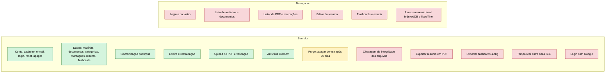
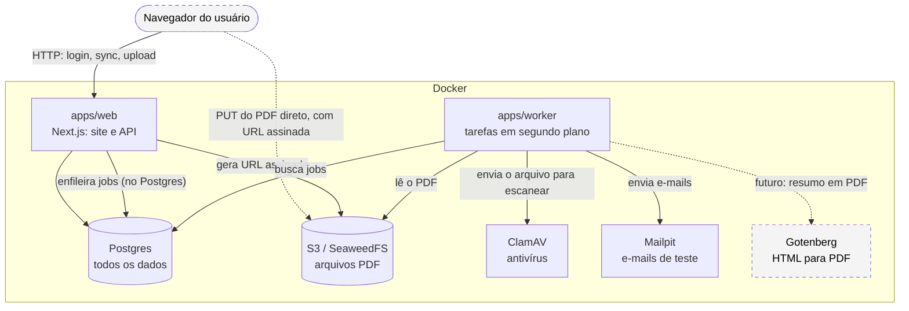
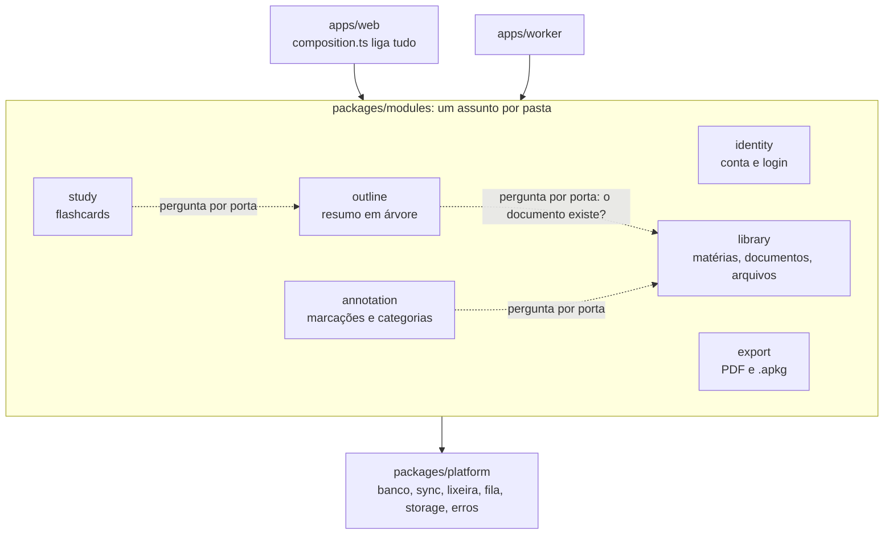
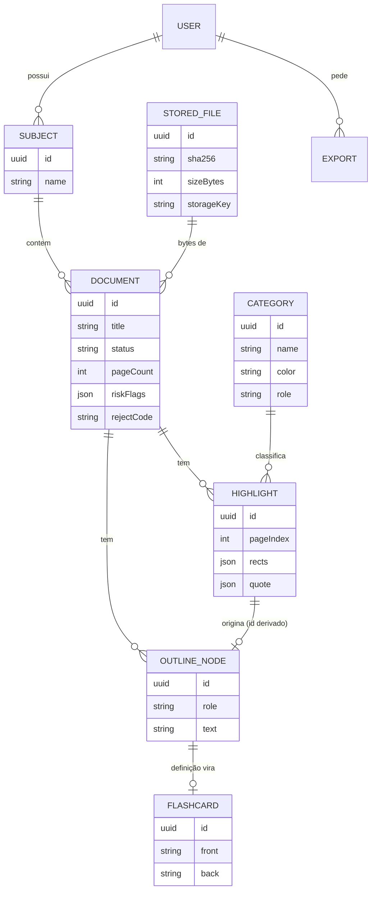
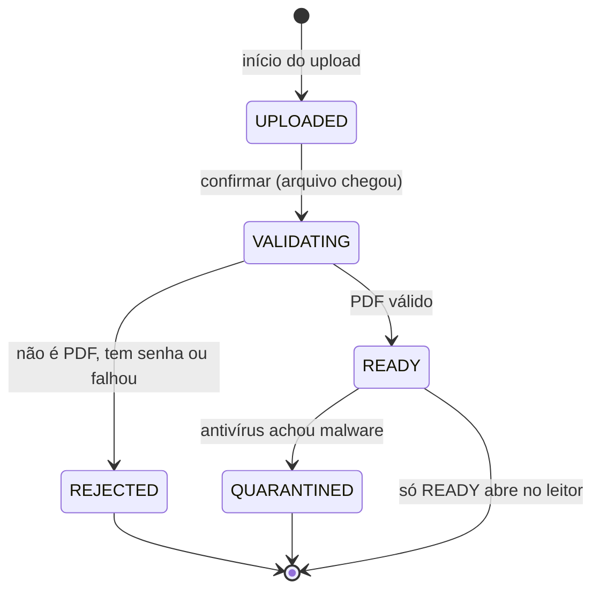
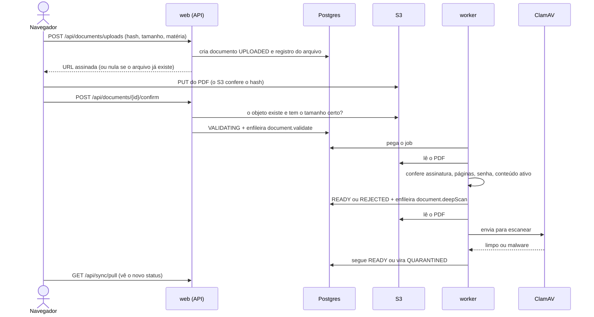
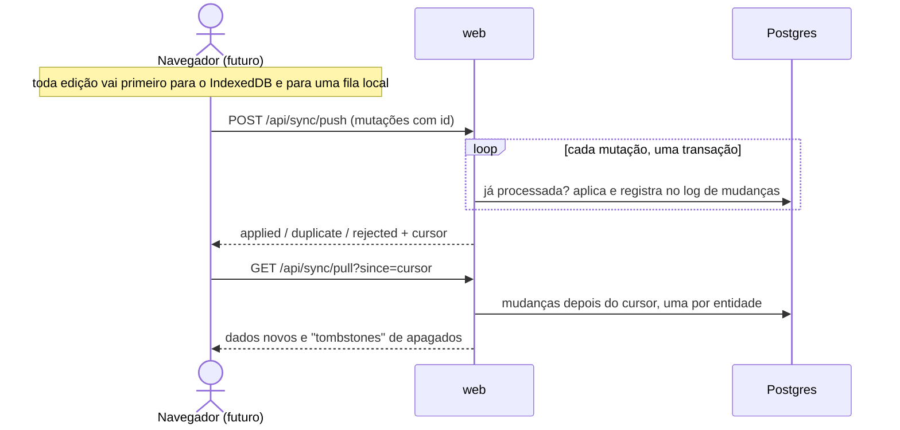
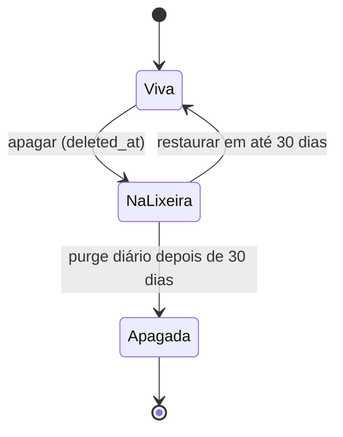

# Grifo: visão geral

> Documento em português, escrito para o dono do projeto entender o que existe. É a exceção à regra "docs em inglês". As fontes da verdade continuam sendo `docs/adr/` (por quê), `docs/specs/` (o quê) e o código. Estado em 27/11/2026, depois do PR #21.

## 1. O que é o Grifo
Você importa **PDFs** de uma **matéria**, **marca trechos** e dá a cada marcação uma **categoria**. As marcações viram um **resumo em árvore**, as **definições** viram **flashcards**, e no fim você exporta o resumo em PDF e os flashcards para o Anki. Os nomes oficiais estão em [`specs/glossary.md`](specs/glossary.md).

## 2. Estado atual: o que existe e o que falta
O projeto é, hoje, **só o servidor**. Não há nenhuma tela.

Legenda: verde = pronto e testado no `main`; amarelo = em andamento; vermelho = não começou.

## 3. As peças e como se falam

Linhas pontilhadas e caixas tracejadas ainda não existem ou ainda não são usadas. A fila de jobs é o próprio Postgres (Graphile Worker), por isso não há Redis.

## 4. Como o código está organizado

Regras que mantêm isso arrumado: um módulo só importa outro pelo pacote raiz; cada módulo é dono de um schema do Postgres, sem consulta ou chave estrangeira entre schemas; a lógica de negócio fica nos módulos e as rotas só traduzem HTTP.

## 5. O modelo de dados

Toda linha tem `owner_id` e o banco só deixa cada usuário ver as próprias (RLS). Apagar nunca apaga de verdade na hora: marca `deleted_at`.

## 6. Ciclo de vida de um documento

## 7. Fluxo de um upload de PDF

## 8. Fluxo de sincronização

Cada mutação tem um id e é aplicada no máximo uma vez, então reenviar depois de uma queda de rede é seguro.

## 9. A lixeira

Uma linha apagada fica invisível e somente leitura. Os filhos apagados em cascata voltam junto com o item que os apagou.

## 10. Onde está cada coisa

| Quero entender | Olhe em |
| --- | --- |
| O que o produto faz, por assunto | `docs/specs/<assunto>/` |
| Por que uma decisão foi tomada | `docs/adr/` (38 decisões) |
| O que ainda está em aberto | `docs/pending/` |
| Os nomes oficiais | `docs/specs/glossary.md` |
| As regras para quem programa | `CLAUDE.md` na raiz e em cada app e módulo |
| Como rodar | `docker compose up -d` e `pnpm dev` (só a API responde; não há tela) |

## 11. Perguntas frequentes
- **Preciso de chave do Google?** Não. Cadastro e login funcionam com e-mail e senha. O login com Google nunca foi implementado.
- **Onde ficam os arquivos nos testes locais?** No SeaweedFS, um contêiner do próprio Docker. Não há nuvem nem custo.
- **Por que há tanta estrutura sem tela?** O servidor foi feito antes do navegador, por decisão do projeto. O próximo passo natural é uma fatia visível de ponta a ponta.
