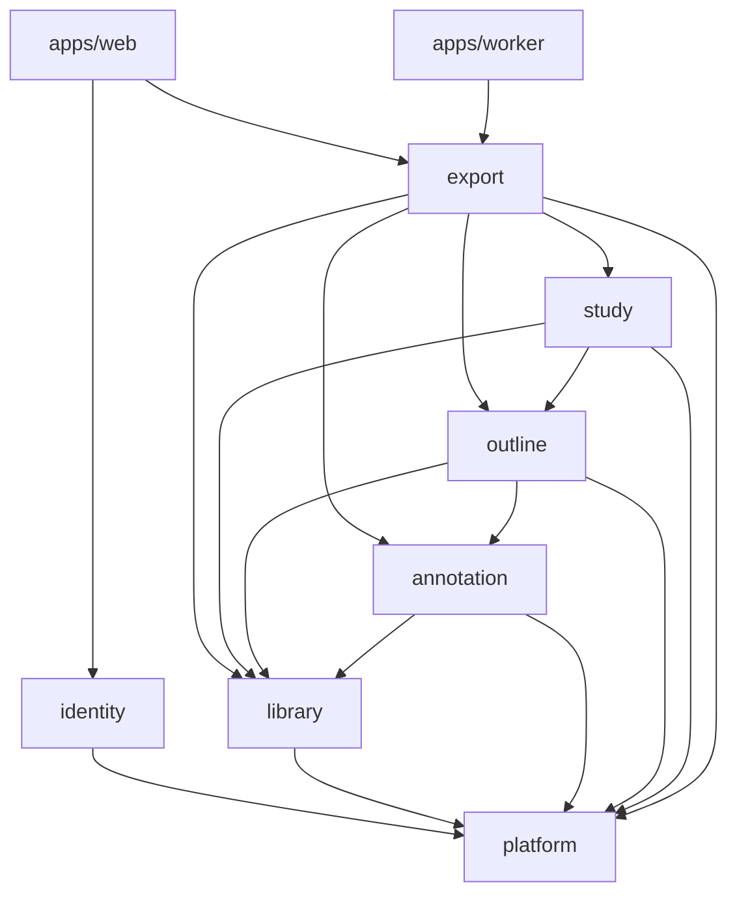

# Module map

Arrows point to dependencies. A module may only import the public API of modules below it. Lower modules trigger reactions in higher ones through in-process events (`@app/platform` events), never through imports.

| Module | Schema | Owns |
| --- | --- | --- |
| identity | `identity` | User (+ auth tables, P-005) |
| library | `library` | Subject, Document, StoredFile |
| annotation | `annotation` | Highlight, Category |
| outline | `outline` | OutlineNode |
| study | `study` | Flashcard (Deck is a projection) |
| export | `export` | Export (SummaryTemplate in code) |
| platform | `platform` | change log, processed mutations |
